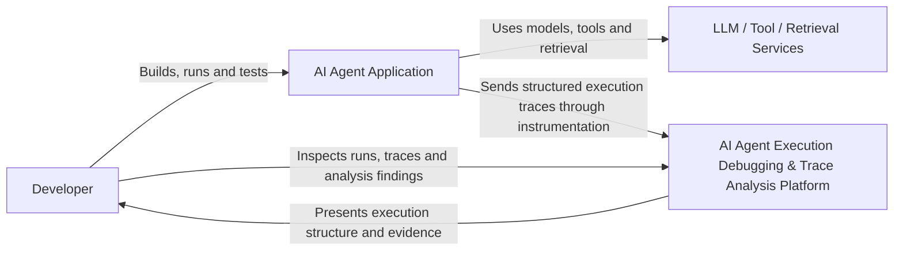
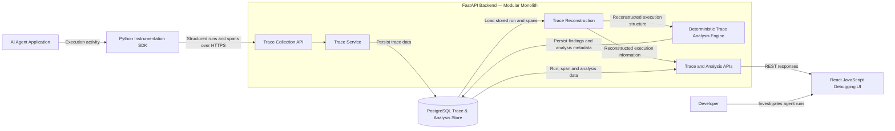
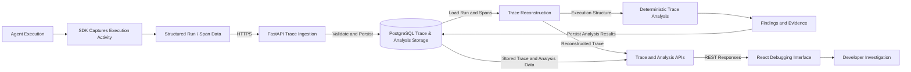
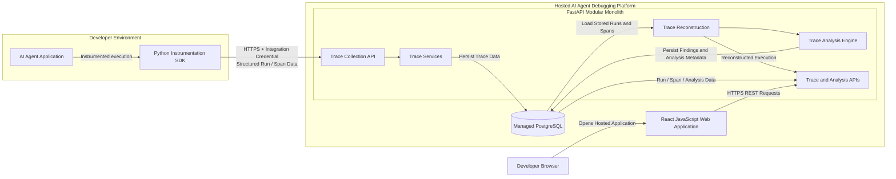

# High-Level Design (HLD)
## AI Agent Execution Debugging & Trace Analysis Platform

## 1. Purpose and Audience

### 1.1 Purpose

This High-Level Design (HLD) describes the architecture of the **AI Agent Execution Debugging & Trace Analysis Platform**.

It defines the major system components, their responsibilities and boundaries, the flow of execution data through the platform, the deployment model, key technology choices, reliability and security considerations, and the main architectural decisions for the OJT implementation.

Implementation-level details such as API schemas, database tables, trace protocol fields, analysis rule contracts, and internal module behavior are documented separately in the LLD and supporting technical documents.

### 1.2 Audience

This document is intended for:

- developers implementing and maintaining the project;
- the OJT mentor and evaluators;
- future contributors extending the platform.

A reader should be able to understand the overall system structure and data flow without inspecting the source code.


## 2. Project Overview

The **AI Agent Execution Debugging & Trace Analysis Platform** is a developer-focused system for understanding and debugging AI agent executions.

An agent run may involve model calls, retrieval operations, tool interactions, external APIs, state changes, retries, and failures. When the final result is incorrect, ordinary logs or the final response may not clearly show which execution step contributed to the problem.

The platform captures agent activity as structured trace data using a common **Run/Span model**. Relationships such as parent-child links, timestamps, and sequence information are used to reconstruct the execution as a structured run.

A deterministic Trace Analysis Engine evaluates observable execution signals such as explicit failures, timeouts, and invalid execution relationships. It produces evidence-backed findings that highlight suspicious execution steps.

The platform does not claim to automatically prove root cause. Its purpose is to help developers narrow the investigation by showing what happened, where suspicious behavior occurred, and what recorded evidence supports each finding.

Developers investigate captured runs through a hosted debugging interface containing run exploration, execution graph or timeline views, span inspection, findings, and supporting evidence.

### 2.1 Product Positioning

The OJT implementation is **development-first and production-aware**.

It primarily targets developers building and testing Python-based AI agents. Developers instrument their applications using the Python SDK, send structured traces to the hosted platform, and inspect those executions through the web interface.

The OJT version is intended to be a complete and deployable developer tool, not a production-scale observability platform.

Future evolution may introduce capabilities such as higher-volume ingestion, sampling, retention policies, selective payload capture, redaction, and additional storage strategies.

### 2.2 Core Debugging Approach

The platform follows the workflow:

**Capture → Store → Reconstruct → Analyze → Inspect**

1. **Capture** structured execution activity from the agent.
2. **Store** the recorded run and spans.
3. **Reconstruct** execution relationships and ordering.
4. **Analyze** the trace using deterministic checks.
5. **Inspect** the execution and evidence through the debugging interface.

Recorded trace data represents what happened during execution, while analysis findings are derived interpretations used to guide investigation.


## 3. Goals and Non-Goals

### 3.1 Goals

The OJT implementation should provide a complete structured agent-debugging workflow that allows developers to:

1. capture agent executions using a Python instrumentation SDK and common Run/Span representation;
2. persist and retrieve captured runs and spans;
3. reconstruct execution structure using identifiers, parent-child relationships, timestamps, and sequence information;
4. analyze traces using a small set of transparent deterministic checks;
5. rank suspicious execution steps using a debugging heuristic rather than a causal probability;
6. provide evidence explaining why each analysis finding was produced;
7. inspect runs through a debugging interface containing execution structure, span details, findings, and evidence;
8. evaluate the workflow using a controlled sample agent with deliberately injected failures and known expected results;
9. deploy the system as a hosted developer tool that can be integrated with Python AI agents.

### 3.2 Non-Goals

The initial OJT implementation does not aim to provide:

- guaranteed root-cause detection;
- ML- or LLM-based diagnosis as a core dependency;
- production-scale observability infrastructure;
- integrations for every AI-agent framework;
- arbitrary distributed or multi-agent execution graphs;
- enterprise IAM, SSO, complex RBAC, billing, or organization management;
- replay and counterfactual debugging as required OJT functionality;
- replacement of general-purpose observability platforms.

Replay and counterfactual debugging remain part of the longer-term project direction, while the OJT focuses on structured trace capture, reconstruction, deterministic analysis, and developer investigation.

## 4. System Context

The **AI Agent Execution Debugging & Trace Analysis Platform** operates alongside the AI agent application being debugged.

It does not control the agent's decisions or replace its models, tools, retrieval systems, or orchestration logic. Its role is to receive structured execution information, analyze recorded traces, and present debugging evidence to developers.

The main external actors and systems are:

### 4.1 Developer

The developer is the primary user of the platform.

The developer:

- builds and runs an AI agent;
- integrates it using the Python instrumentation SDK;
- opens the hosted debugging interface;
- browses captured runs;
- inspects execution steps, findings, and evidence;
- uses this information to investigate unexpected behavior.

The platform supports investigation but does not make the final debugging decision for the developer.

### 4.2 AI Agent Application

The AI Agent Application is the system being observed.

Its execution may include:

- model calls;
- retrieval operations;
- tool interactions;
- external API calls;
- state changes;
- retries;
- failures or timeouts.

The Python SDK captures selected execution activity and sends structured trace information to the hosted platform.

The agent remains independent from the debugger's internal architecture.

### 4.3 External Execution Services

The agent may depend on external systems such as:

- LLM providers;
- application tools and APIs;
- retrieval systems;
- vector databases;
- other external services.

These are dependencies of the AI agent, not direct dependencies of the debugging platform.

The platform observes interactions with them only through information captured by instrumentation.

### 4.4 Debugging Platform

At the system-context level, the platform is responsible for:

- receiving structured traces;
- storing captured executions;
- reconstructing execution relationships;
- applying deterministic trace analysis;
- producing evidence-backed findings;
- presenting debugging information through the hosted interface.

### 4.5 System Context Diagram

[System Context Diagram](./diagrams/system_context_diagram.mermaid)



### 4.6 System Boundary

Inside the debugging platform are:

- trace collection;
- persistence;
- reconstruction;
- analysis;
- backend APIs;
- the debugging interface.

Outside the platform are:

- the developer's AI agent;
- models;
- tools and APIs;
- retrieval systems.

This boundary allows the debugger to support different Python-based AI agents without owning their execution logic.

## 5. High-Level Architecture

The platform uses a **modular monolith backend**, a separate Python instrumentation SDK, PostgreSQL storage, and a React JavaScript frontend.

The architecture separates major responsibilities while keeping the OJT implementation simple to develop, test, deploy, and maintain.

The major components are:

1. AI Agent Application
2. Python Instrumentation SDK
3. FastAPI Backend
4. PostgreSQL Trace & Analysis Store
5. Trace Reconstruction Layer
6. Deterministic Trace Analysis Engine
7. Trace and Analysis APIs
8. React JavaScript Debugging Interface

The primary execution flow is:

**AI Agent → Instrumentation SDK → Trace Collection → Trace Storage → Trace Reconstruction → Trace Analysis → Trace and Analysis APIs → Debugging Interface**

### 5.1 Architectural Style

The backend follows a modular monolith approach.

```
FastAPI Backend
│
├── Trace Collection
├── Trace Services
├── Trace Reconstruction
├── Trace Analysis Engine
└── Trace and Analysis APIs
```

These modules have separate responsibilities but run as one FastAPI application.

This avoids unnecessary distributed-system complexity while preserving clear internal boundaries that could be extracted later if real scale requirements appear.

### 5.2 Agent-Side Instrumentation

The Python instrumentation SDK runs inside the developer's AI agent application.

It converts execution activity into the platform's common trace representation and exports structured Run and Span data to the hosted backend over HTTPS.

The SDK does not access PostgreSQL or depend on backend internals.

The documented trace protocol and ingestion API form the integration boundary between the agent and the platform.

### 5.3 Trace Collection and Persistence

The Trace Collection API receives structured trace data from the SDK.

Incoming data is validated and passed through the Trace Service before being persisted in PostgreSQL.

PostgreSQL acts as the durable store for captured executions.

Persisting traces allows:

- inspection after execution finishes;
- historical debugging;
- repeated analysis as rules evolve;
- controlled evaluation;
- future extension toward replay-related capabilities.

Recorded trace data remains separate from derived analysis findings.

### 5.4 Trace Reconstruction

Stored spans may arrive at the backend in a different order from their actual execution order.

The Trace Reconstruction Layer therefore rebuilds execution structure using information such as:

- span identifiers;
- parent-child relationships;
- timestamps;
- sequence information.

The reconstructed trace is then used by the analysis engine and by backend APIs serving the debugging interface.

### 5.5 Deterministic Trace Analysis

The Trace Analysis Engine applies transparent deterministic checks to reconstructed traces.

Its purpose is to identify observable suspicious conditions and produce findings containing supporting evidence.

The engine remains part of the FastAPI backend during the OJT implementation.

It is logically separated so that analysis could evolve into independent or asynchronous processing later if required.

### 5.6 Debugging Access

The backend exposes APIs through which the frontend can retrieve:

- runs;
- spans;
- reconstructed execution information;
- analysis findings;
- supporting evidence.

The frontend does not access PostgreSQL or analysis modules directly.

All debugging data passes through the backend API boundary.

### 5.7 High-Level Architecture Diagram

[High-Level Architecture Diagram](diagrams/high_level_architecture.mermaid)


### 5.8 Architectural Boundaries

The architecture maintains the following ownership boundaries:

- **AI Agent** — execution logic;
- **Python SDK** — instrumentation and trace export;
- **FastAPI Backend** — ingestion, application logic, reconstruction, analysis, and data access;
- **PostgreSQL** — durable execution and analysis data;
- **React Frontend** — developer-facing debugging experience.

These boundaries reduce coupling between the agent being observed and the debugging platform.

## 6. Major Component Responsibilities

This section summarizes the responsibilities of the major system components.

### 6.1 AI Agent Application

The AI Agent Application is the external system being observed.

It owns the actual execution logic, including model calls, retrieval, tools, state changes, orchestration, and external API interactions.

The debugger observes this activity but does not control it.

### 6.2 Python Instrumentation SDK

The SDK captures meaningful execution activity and converts it into structured Run and Span data.

Its responsibilities are:

- create and manage trace context;
- capture execution metadata;
- represent operations using the common trace model;
- export trace data to the hosted ingestion API.

It does not perform persistence, analysis, or UI rendering.

### 6.3 Trace Collection API

The Trace Collection API is the external HTTP entry point for SDK trace submissions.

It is responsible for:

- receiving Run and Span data;
- validating requests;
- applying integration access checks;
- forwarding valid operations to backend services.

It should not contain persistence or analysis logic.

### 6.4 Trace Service

The Trace Service coordinates trace-related application operations.

Its responsibilities include:

- creating and updating runs;
- ingesting spans;
- coordinating persistence;
- retrieving stored traces;
- applying trace lifecycle and duplicate-handling rules.

It separates API request handling from persistence and application logic.

### 6.5 PostgreSQL Trace & Analysis Store

PostgreSQL provides durable storage for:

- projects;
- runs;
- spans;
- execution metadata;
- analysis metadata;
- analysis findings.

All database access occurs through backend services and repositories.

The SDK and frontend never communicate directly with PostgreSQL.

### 6.6 Trace Reconstruction Layer

The reconstruction layer rebuilds the logical execution structure from stored Run and Span data.

It uses:

- identifiers;
- parent-child relationships;
- timestamps;
- sequence information.

It produces ordered execution structure and structural validation information for analysis and debugging APIs.

### 6.7 Deterministic Trace Analysis Engine

The analysis engine evaluates reconstructed traces using deterministic rules.

It produces evidence-backed findings containing information such as:

- suspicious span;
- triggered rule;
- failure category;
- severity;
- suspicion ranking;
- supporting evidence.

It does not modify the original trace or claim guaranteed root cause.

### 6.8 Trace and Analysis APIs

These APIs expose stored and derived debugging information to the frontend.

They provide access to:

- run lists;
- run details;
- spans;
- reconstructed execution information;
- findings and evidence.

They form the boundary between backend behavior and the debugging interface.

### 6.9 React JavaScript Debugging Interface

The React frontend presents captured execution information to developers.

Its main views include:

- Run Explorer;
- execution graph or timeline;
- Step Inspector;
- analysis findings;
- supporting evidence.

The frontend remains a presentation layer and does not perform persistence, trace reconstruction, or analysis.

### 6.10 Controlled Sample Agent and Evaluation Scenarios

The sample agent provides reproducible successful and failing executions for end-to-end evaluation.

It behaves like an external SDK consumer and is used to validate:

- trace capture;
- persistence;
- reconstruction;
- analysis;
- debugging presentation.

Known expected failures are used only for evaluation and are never exposed to the analysis engine.

## 7. End-to-End Data Flow

Execution data moves through the platform using the following high-level flow:

**Agent Execution → Trace Capture → Trace Ingestion → Trace Storage → Trace Reconstruction → Trace Analysis → Trace and Analysis APIs → Debugging Interface → Developer Investigation**

### 7.1 Trace Capture

A developer runs an AI agent instrumented with the Python SDK.

During execution, the SDK records meaningful operations as Runs and Spans. Captured information may include:

- operation type;
- parent-child relationship;
- status;
- timestamps;
- sequence information;
- relevant inputs and outputs;
- errors;
- execution metadata.

The SDK converts application-specific activity into the platform's common trace representation.

### 7.2 Trace Ingestion and Persistence

The SDK sends structured trace data to the hosted Trace Collection API over HTTPS using the project's integration credential.

The backend:

1. validates the incoming trace data;
2. associates it with the correct project and run;
3. passes it to the Trace Service;
4. persists the accepted execution data in PostgreSQL.

The arrival order of trace requests is not treated as the authoritative execution order.

### 7.3 Trace Reconstruction

When a run is inspected or analyzed, stored Run and Span data is loaded from PostgreSQL.

The Trace Reconstruction Layer rebuilds execution structure using:

- span identifiers;
- parent-child relationships;
- timestamps;
- sequence information.

It may also identify structural problems such as missing or invalid relationships.

### 7.4 Trace Analysis

The reconstructed trace is evaluated by the deterministic Trace Analysis Engine.

Initial analysis signals include:

- explicit execution failures;
- timeout conditions;
- missing or invalid execution relationships.

When a rule triggers, the engine produces a finding containing the suspicious span, triggered rule, failure category, severity, suspicion ranking, and supporting evidence.

Analysis results are derived from the recorded trace and do not modify it.

### 7.5 Debugging Access

Trace and analysis information is exposed to the React frontend through backend APIs.

A developer can then:

- browse captured runs;
- inspect the execution graph or timeline;
- inspect individual spans;
- review errors, inputs, outputs, and metadata;
- review analysis findings and supporting evidence.

The platform helps narrow the investigation while leaving the final debugging judgment to the developer.

### 7.6 End-to-End Data Flow Diagram

[End-to-End Data Flow Diagram](diagrams/end_to_end_data_flow.mermaid)



### 7.7 Recorded and Derived Data

The platform distinguishes between:

**Recorded execution data**

* Runs;
* Spans;
* execution relationships;
* statuses;
* timing;
* captured metadata.

**Derived analysis data**

* findings;
* failure categories;
* severity;
* suspicion rankings;
* supporting evidence.

Recorded trace data remains the source of evidence and can be inspected independently of the analysis derived from it.

## 8. High-Level Data Concepts

The platform uses a small common data model for representing executions and debugging results.

Conceptually:

```text
Project
│
└── Run
    ├── Spans
    │   ├── Span
    │   ├── Span
    │   │   └── Child Span
    │   └── Span
    │
    └── Analysis Findings
        └── Evidence
```

Exact fields, constraints, schemas, and database representation are defined in `trace-protocol.md` and `database.md`.

### 8.1 Project

A Project represents an AI agent integration within the platform.

It provides:

* a logical grouping for agent executions;
* an access boundary for captured traces;
* the association between SDK integration credentials and Runs.

A project may represent, for example, a refund agent, support agent, or research agent.

Enterprise organization management and complex tenancy are outside the OJT scope.

### 8.2 Run

A Run represents one complete execution of an AI agent for a request, task, or workflow.

It acts as the top-level container for the Spans recorded during that execution.

A developer primarily investigates executions at the Run level through the Run Explorer and Run Detail views.

### 8.3 Span

A Span represents one meaningful operation within a Run.

Examples include:

* model calls;
* retrieval operations;
* tool interactions;
* external API operations;
* state changes.

A Span contains the information needed to understand that execution step, including identity, relationship, status, timing, relevant payloads, errors, and metadata where captured.

### 8.4 Execution Relationships and Ordering

Spans use parent-child relationships to describe execution hierarchy.

For example:

```text
Agent Run
│
├── Understand Request
├── Retrieve Policy
└── Process Refund
    ├── Validate Order
    └── Issue Refund
```

Timing and sequence information supplement these relationships when reconstructing execution order.

Backend arrival order is not considered authoritative execution order.

The initial system supports this controlled parent-child model rather than arbitrary distributed execution graphs.

### 8.5 Finding and Evidence

A Finding is a derived result produced by the Trace Analysis Engine.

A finding may contain:

* suspicious span;
* triggered rule;
* failure category;
* severity;
* suspicion ranking;
* supporting evidence.

Evidence is the observable recorded information that explains why the rule triggered, such as:

* a failed status;
* recorded error;
* timeout condition;
* invalid parent relationship.

A finding helps guide investigation but is not proof of root cause.

### 8.6 Recorded vs. Derived Information

The platform deliberately separates:

```text
Recorded Execution
        ↓
Reconstruction
        ↓
Deterministic Analysis
        ↓
Findings + Evidence
```

This allows the original execution to remain inspectable even if analysis rules or ranking logic change later.

## 9. Deployment Architecture

The platform is designed as a **hosted developer service**.

Developers integrate their AI agents using the Python SDK and inspect captured executions through the hosted web interface.

The hosted deployment contains three primary components:

1. React JavaScript Web Application
2. FastAPI Backend
3. Managed PostgreSQL Database

The Python SDK runs inside the developer's AI agent environment and communicates with the hosted backend over HTTPS.

### 9.1 Developer Environment

The developer's environment contains:

```text
AI Agent Application
        │
        └── Python Instrumentation SDK
```

The SDK captures execution activity and exports structured traces to the hosted platform.

The debugger does not require direct access to the developer's application environment.

### 9.2 SDK-to-Platform Communication

Trace data is submitted using:

```text
AI Agent
   ↓
Python SDK
   ↓
HTTPS + Project Integration Credential
   ↓
Hosted Trace Collection API
```

The integration credential identifies the project associated with incoming traces and protects the ingestion API from unrestricted anonymous submissions.

Exact credential generation, validation, storage, and revocation behavior belongs in the LLD.

### 9.3 Hosted Web Application

The React JavaScript frontend is deployed separately from the backend and accessed through the developer's browser.

It provides:

* Run Explorer;
* run details;
* execution graph or timeline;
* Step Inspector;
* findings and evidence.

The frontend communicates with FastAPI over HTTPS and never accesses PostgreSQL directly.

### 9.4 FastAPI Backend

The backend is deployed as a single modular-monolith application containing:

```text
FastAPI Backend
│
├── Trace Collection
├── Trace Services
├── Trace Reconstruction
├── Trace Analysis Engine
└── Trace and Analysis APIs
```

These are logical modules rather than separately deployed services during the OJT.

### 9.5 Managed PostgreSQL

Managed PostgreSQL provides persistent storage for:

* projects;
* runs;
* spans;
* execution metadata;
* analysis metadata;
* analysis findings.

Database access occurs only through the backend.

Neither the SDK nor the frontend receives direct database access.

### 9.6 External Deployment Flows

#### Trace Ingestion

```text
Developer AI Agent
        ↓
Python SDK
        ↓
HTTPS + Project Credential
        ↓
FastAPI Backend
        ↓
PostgreSQL
```

#### Debugging

```text
Developer Browser
        ↓
React Web Application
        ↓
HTTPS
        ↓
FastAPI Backend
        ↓
PostgreSQL / Analysis
```

### 9.7 Docker and Configuration

Docker is used internally for reproducible development, integration testing, CI, and backend deployment.

It is **not** a user-facing self-hosting requirement.

A developer using the hosted product interacts with:

* the Python SDK;
* the hosted web interface.

Deployment-specific values such as database URLs, application URLs, allowed origins, and secrets are supplied through environment configuration.

Real secrets are not committed to the repository; `.env.example` may document expected configuration.

### 9.8 Deployment Architecture Diagram

[Deployment Architecture Diagram](diagrams/deployment_architecture.mermaid)



### 9.9 Deployment Scope

The OJT deployment demonstrates a complete hosted debugging workflow for development and controlled testing use cases.

It does not require:

* multi-region deployment;
* automatic horizontal scaling;
* distributed ingestion pipelines;
* high-availability database clusters;
* large-scale retention infrastructure;
* enterprise identity infrastructure.

These may be considered later if actual usage requires them.

## 10. Technology Choices

The technology stack is selected to support the architecture while remaining practical to implement, test, deploy, and maintain during the OJT.

| Area | Technology | Primary Role |
|---|---|---|
| Core backend language | Python | Backend, analysis engine, SDK, and sample agent |
| Backend framework | FastAPI | Trace ingestion and debugging APIs |
| Data validation | Pydantic | Validation and serialization of API and trace data |
| Database | PostgreSQL | Persistent storage of projects, runs, spans, and findings |
| Flexible execution data | PostgreSQL JSONB | Variable model, tool, retrieval, and execution payloads |
| Database access | SQLAlchemy 2.x | Structured asynchronous database interaction |
| Schema migrations | Alembic | Versioned database schema changes |
| HTTP client | HTTPX | SDK-to-backend communication |
| Frontend | React with JavaScript | Developer-facing debugging interface |
| Frontend tooling | Vite | Frontend development and production builds |
| Containerization | Docker | Reproducible development and backend deployment |
| Version control | Git and GitHub | Source control and collaboration |

### 10.1 Backend and SDK

Python is used for:

- the instrumentation SDK;
- FastAPI backend;
- trace reconstruction;
- deterministic analysis rules;
- controlled sample agent;
- backend and SDK testing.

FastAPI provides the HTTP boundary for SDK ingestion and frontend debugging APIs.

Pydantic validates structured API and trace data, while application logic remains outside route handlers.

The Python SDK uses HTTPX to send trace information to the hosted backend over HTTPS.

### 10.2 PostgreSQL Persistence

PostgreSQL is the primary persistent data store because trace data contains both structured and flexible information.

Structurally important fields such as:

- identifiers;
- project association;
- parent relationships;
- event type;
- status;
- timestamps;

are stored relationally.

Variable information such as model payloads, tool arguments/results, retrieval metadata, errors, and additional attributes can be stored using JSONB.

SQLAlchemy 2.x provides asynchronous database interaction, while Alembic manages versioned schema migrations.

Detailed tables, constraints, indexes, and JSONB usage are defined in `database.md`.

### 10.3 Frontend

The debugging interface uses **React with JavaScript and JSX**, built with Vite.

The frontend provides interactive views such as:

- Run Explorer;
- Run Detail;
- execution graph or timeline;
- Step Inspector;
- findings and evidence.

The frontend remains a presentation layer and does not contain persistence, trace reconstruction, or analysis logic.

A graph library such as React Flow may be introduced when needed, but it is not a core architectural dependency.

### 10.4 Docker

Docker provides a reproducible environment for backend development, testing, CI, and hosted deployment.

It is an internal engineering and deployment mechanism rather than a requirement for developers using the hosted product.

### 10.5 Technologies Intentionally Not Introduced

The OJT architecture does not currently require:

- Kafka;
- RabbitMQ;
- Redis;
- Celery;
- Kubernetes;
- Elasticsearch;
- service meshes;
- independently deployed microservices.

These technologies should be introduced only if future measured requirements justify their additional complexity.


## 11. Reliability and Failure Handling

The reliability goal of the platform is:

> **A failure in the debugging platform should not normally cause the instrumented AI agent itself to fail.**

Detailed retry counts, timeout values, transaction behavior, and exception-handling implementation belong in the LLD and technical documents.

### 11.1 SDK Failure Isolation

Because the Python SDK runs inside the developer's agent application, trace-export failures should normally be **fail-open**.

If the debugging backend is unavailable or a trace request fails, the SDK should avoid turning that failure into an agent application failure.

Any retry or timeout behavior should be bounded so that instrumentation does not block the agent indefinitely.

### 11.2 Validation and Idempotency

Incoming trace data is validated before persistence.

Malformed or unauthorized requests should fail clearly without affecting unrelated runs.

The ingestion workflow should also support basic idempotency:

- an equivalent duplicate Span submission may be accepted safely;
- conflicting content using the same Span identifier should be treated as an error.

Detailed duplicate-detection rules are defined in the trace protocol.

### 11.3 Out-of-Order and Incomplete Traces

Trace arrival order is not treated as execution order.

Spans may arrive out of order because of asynchronous execution or network behavior.

Reconstruction therefore relies on:

- span identifiers;
- parent relationships;
- timestamps;
- sequence information.

If a trace is incomplete, the platform should preserve the information that was successfully captured rather than discarding the entire Run.

The debugger should distinguish between:

- an error that occurred in the agent; and
- missing or incomplete telemetry.

### 11.4 Persistence and Reconstruction Failures

PostgreSQL is the durable source of captured execution data.

If persistence fails, the backend should not report the affected trace data as successfully stored.

Malformed execution relationships should not cause the entire backend to fail. Where possible, reconstruction should preserve usable portions of the trace and report structural problems such as:

- missing parents;
- invalid parent references;
- self-referencing relationships.

Detailed transaction behavior belongs in the LLD.

### 11.5 Analysis and Frontend Failures

Analysis is a derived-processing layer and must not corrupt the recorded execution.

If analysis fails:

- the original trace remains available;
- the developer should still be able to inspect the Run;
- the UI should indicate that analysis results are unavailable.

The system should preserve enough analysis metadata to identify which analysis configuration or version produced a set of findings.

### 11.6 Reliability Scope

The OJT implementation focuses on application-level reliability needed for a dependable debugging workflow.

It does not require:

- multi-region failover;
- distributed consensus;
- replicated ingestion pipelines;
- cross-region recovery;
- large-scale durable queues;
- enterprise high-availability infrastructure.

These capabilities may be considered later if production usage requires them.


## 12. Security and Data Considerations

Trace data may contain model inputs and outputs, tool arguments and results, retrieved information, application state, errors, and other potentially sensitive execution data.

The OJT implementation therefore provides a practical security baseline for a hosted developer debugging tool without attempting to implement enterprise security infrastructure.

### 12.1 Secure Communication

External communication with the hosted platform should use HTTPS.

This includes:

```text
AI Agent + SDK
      ↓
HTTPS
      ↓
FastAPI Backend
```

and:

```text
Developer Browser
      ↓
HTTPS
      ↓
Hosted Web Application / Backend APIs
```

Neither the SDK nor the browser communicates directly with PostgreSQL.

### 12.2 Project-Scoped Integration Access

The public trace-ingestion API should not accept unrestricted anonymous submissions.

Each SDK integration is associated with a Project through a project-scoped integration credential.

Conceptually:

```text
Project
   ↓
Integration Credential
   ↓
Python SDK
   ↓
Trace Ingestion API
```

The backend validates the credential and associates incoming traces with the correct Project.

Integration credentials should be treated as secrets, stored using a non-reversible representation where practical, and support revocation.

Exact generation, validation, hashing, rotation, and revocation behavior belongs in the LLD.

### 12.3 Project Data Isolation

Runs and Spans belong to a Project.

Backend operations should therefore remain scoped to the appropriate Project rather than exposing all traces as one unrestricted dataset.

The initial system does not require organizations, advanced tenancy, complex RBAC, billing, or enterprise account management.

### 12.4 Human and Machine Access

SDK access and developer web access serve different purposes.

```text
AI Agent + SDK
      ↓
Integration Credential
      ↓
Trace Ingestion


Developer
      ↓
Developer Authentication
      ↓
Debugging Interface
```

The SDK integration credential should not be used as a general human login credential.

The OJT deployment will use a minimal developer authentication mechanism sufficient to restrict access to the appropriate debugging data.

A complete self-service SaaS identity system is not required.

### 12.5 Sensitive Trace Data and Secrets

Trace payloads may contain sensitive information.

The initial controlled environment may capture detailed payloads for debugging, but the architecture should not assume that all payloads must always be stored completely.

Deployment and application secrets such as:

* database credentials;
* integration keys;
* third-party API keys;
* hosting secrets;

must not be committed to the repository.

Environment variables or hosting-platform secret management should be used instead.

The repository may provide `.env.example` without containing real credentials.

### 12.6 Request and Browser Controls

The externally accessible ingestion API should enforce reasonable request and payload limits to reduce accidental or abusive resource usage.

Exact numerical limits belong in the detailed protocol and API design.

Browser access should use deliberate CORS configuration rather than unrestricted origins.

CORS controls browser-origin access but is not treated as an authentication mechanism.

### 12.7 Analysis Data Integrity

Analysis findings are derived from recorded trace data and should not modify the original execution.

```text
Recorded Execution
        ↓
Deterministic Analysis
        ↓
Derived Findings
```

This preserves the recorded trace as independently inspectable evidence.

### 12.8 Future Production Controls

A future production-oriented version may introduce:

* trace sampling;
* selective payload capture;
* sensitive-data redaction;
* retention and deletion policies;
* storage tiering;
* stronger user and project isolation;
* audit logging;
* advanced credential management.

These are future production capabilities rather than OJT requirements.

### 12.9 Security Scope

The OJT security baseline includes:

* HTTPS;
* protected trace ingestion;
* project-scoped trace access;
* safe secret handling;
* backend-only database access;
* reasonable request limits;
* awareness of sensitive trace payloads.

The OJT does not require enterprise capabilities such as SSO, complex RBAC, compliance certification, enterprise audit infrastructure, or advanced data-loss-prevention systems.

## 13. Scalability and Evolution

The initial architecture is optimized for a complete and manageable OJT implementation rather than for production-scale telemetry workloads.

The scalability strategy is:

> **Keep the current system simple, measure actual limitations, and evolve individual components only when justified by real requirements.**

### 13.1 Current Scaling Model

The initial platform uses:

```text
Trace Ingestion

Python SDK
    ↓
FastAPI Modular Monolith
    ↓
PostgreSQL


Debugging Access

React Web Application
    ↓
FastAPI Modular Monolith
    ↓
PostgreSQL
```

This model is sufficient for development workloads, controlled OJT evaluation, hosted demonstrations, and moderate developer integrations.

Distributed ingestion or worker infrastructure is not required for the initial implementation.

### 13.2 Backend Evolution

The FastAPI backend should avoid relying on important process-local state.

Persistent application data is stored in PostgreSQL, allowing the backend to evolve toward multiple instances later if required.

The existing module boundaries also provide natural separation points for capabilities such as trace ingestion or analysis if they eventually require independent scaling.

### 13.3 Ingestion and Analysis Evolution

The initial workflow performs trace ingestion and deterministic analysis within the modular-monolith backend.

If future workloads create measurable requirements, these areas could evolve toward:

* asynchronous ingestion;
* queues and persistence workers;
* background re-analysis;
* independent analysis workers.

These are future evolution paths rather than current architectural requirements.

### 13.4 Storage Evolution

PostgreSQL remains the primary database for the OJT implementation.

The first scaling improvements should use the existing database effectively through:

* indexing;
* efficient queries;
* pagination;
* targeted JSONB indexes where justified.

Future larger deployments may additionally introduce:

* table partitioning;
* caching;
* configurable trace retention;
* trace sampling;
* object storage for large payloads.

Additional storage systems should be introduced only when workload measurements justify them.

### 13.5 Integration and Frontend Evolution

The backend depends on the common trace protocol rather than on a specific agent framework.

This allows future integrations such as:

* framework-specific instrumentation helpers;
* LangChain or LangGraph adapters;
* OpenTelemetry-compatible adapters;
* additional language SDKs.

The frontend may later evolve with stronger filtering, search, execution comparison, richer graph interaction, and project-level debugging views.

### 13.6 Scalability Scope

The OJT architecture provides:

* clear module boundaries;
* persistent storage;
* stateless backend behavior where practical;
* extensible SDK/backend integration;
* independently evolvable analysis logic.

It does not commit to:

* internet-scale ingestion;
* distributed event processing;
* multi-region infrastructure;
* automatic horizontal scaling;
* production-grade telemetry pipelines;
* enterprise-scale operations.

These capabilities remain future considerations.

## 14. Future Replay and Counterfactual Layer

Replay and counterfactual debugging are part of the longer-term direction of the project but are **not required for the OJT implementation**.

The OJT focuses on establishing the debugging foundation:

**Capture → Store → Reconstruct → Analyze → Inspect**

Replay becomes meaningful only after executions can be recorded and reconstructed reliably.

### 14.1 Replay Concept

A future Replay capability could allow a developer to select a previous execution or execution step and run it again using recorded context.

Conceptually:

```text
Original Run
      ↓
Select Execution Context
      ↓
Replay
      ↓
New Replay Run
```

The replayed execution should be stored separately so that the original recorded execution remains unchanged.

The current OJT implementation does not guarantee that every execution contains all information required for exact deterministic reproduction.

### 14.2 Counterfactual Debugging

Counterfactual debugging could extend Replay by allowing the developer to intentionally modify a selected condition, such as:

* model configuration;
* tool input;
* retrieval result;
* selected state;
* output from an earlier step.

The new execution could then be compared with the original to determine how the changed condition affected downstream behavior.

Conceptually:

```text
Original Execution
        ↓
Modify Selected Condition
        ↓
Counterfactual Execution
        ↓
Compare Outcomes
```

Such comparisons may provide useful debugging evidence but do not automatically prove causal root cause.

### 14.3 Future Architecture

A future implementation may introduce components such as:

```text
Stored Trace
    ↓
Replay Controller
    ↓
Controlled Execution Environment
    ↓
Replay / Counterfactual Run
    ↓
Comparison
```

Replay would also require safety controls for operations with external side effects, such as issuing refunds, sending emails, or modifying external systems.

Possible approaches include sandboxing, mocks, recorded responses, or explicit developer approval.

Detailed Replay architecture belongs in:

[`future/replay-counterfactual.md`](./future/replay-counterfactual.md)

### 14.4 Future Scope Boundary

The OJT does not require:

* replay execution;
* counterfactual execution;
* execution sandboxing;
* replay comparison;
* replay-specific UI;
* causal diagnosis through replay experiments.

The current project only aims to create a trace and debugging foundation that can support investigation of these capabilities later.

## 15. Key Architecture Decisions

The major architecture decisions for the OJT implementation are summarized below.

| Area                 | Decision                                                              | Reason                                                                                   |
| -------------------- | --------------------------------------------------------------------- | ---------------------------------------------------------------------------------------- |
| Backend architecture | FastAPI modular monolith                                              | Maintains clear boundaries without unnecessary distributed-system complexity             |
| Agent integration    | Separate Python instrumentation SDK                                   | Keeps agent instrumentation independent from backend internals                           |
| Trace representation | Common Run/Span model                                                 | Provides a consistent representation across different agent implementations              |
| Execution structure  | Parent-child spans with timing and sequence information               | Sufficient for controlled OJT workflows without arbitrary distributed graphs             |
| Data lifecycle       | Persist recorded trace before treating analysis as debugging evidence | Supports historical inspection, re-analysis, evaluation, and future evolution            |
| Storage              | PostgreSQL with relational fields and JSONB                           | Combines structured querying with flexible execution payloads                            |
| Database access      | SQLAlchemy 2.x with Alembic migrations                                | Provides structured persistence and reproducible schema evolution                        |
| Analysis             | Deterministic, evidence-backed rules                                  | Produces transparent and testable findings                                               |
| Suspicion ranking    | Debugging heuristic, not probability                                  | Avoids unsupported causal or probabilistic claims                                        |
| Product model        | Hosted developer service                                              | Allows developers to integrate through the SDK without operating the debugger themselves |
| Ingestion access     | Project-scoped integration credential                                 | Protects hosted ingestion and associates traces with the correct Project                 |
| Scale strategy       | Development-first and production-aware                                | Avoids premature infrastructure while preserving evolution paths                         |
| Replay               | Future layer, not an OJT requirement                                  | Keeps the initial project focused on completing the debugging foundation                 |

These decisions define the architectural baseline for the OJT implementation. Detailed implementation choices are documented in the LLD and supporting technical documents.

## 16. References

The HLD describes the overall system architecture. More detailed design information is maintained in dedicated documents.

| Document                                                               | Purpose                                                                                               |
| ---------------------------------------------------------------------- | ----------------------------------------------------------------------------------------------------- |
| [`trace-protocol.md`](./trace-protocol.md)                             | Defines the Run/Span contract, ordering, lifecycle, metadata, and duplicate handling                  |
| [`database.md`](./database.md)                                         | Defines PostgreSQL tables, relationships, fields, indexes, constraints, and migrations                |
| [`analysis-engine.md`](./analysis-engine.md)                           | Defines deterministic rules, findings, evidence, taxonomy, severity, ranking, and analysis versioning |
| [`future/replay-counterfactual.md`](./future/replay-counterfactual.md) | Defines the future Replay and Counterfactual direction                                                |
| [`LLD.md`](./LLD.md)                                                   | Defines implementation-level module behavior, API flows, sequences, and internal interactions         |

### 16.1 Documentation Relationship

```text
HLD.md
│
├── System architecture
├── Major components
├── System boundaries
├── Deployment
└── Architecture decisions
        │
        ▼
LLD.md
│
├── Internal module interactions
├── Runtime flows
├── API sequences
└── Implementation behavior
        │
        ├── trace-protocol.md
        ├── database.md
        └── analysis-engine.md
```

This separation keeps the HLD focused on system-level design while allowing implementation details to evolve independently.
