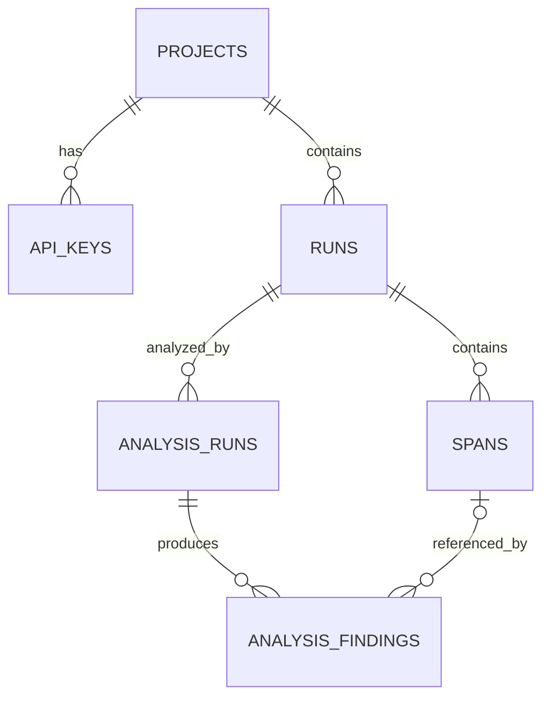

# Database Design

## AI Agent Execution Debugging & Trace Analysis Platform

## 1. Purpose and Scope

This document defines the logical database design for the **AI Agent Execution Debugging & Trace Analysis Platform**.

PostgreSQL is the primary durable store for:

- Projects and integration credentials;
- Runs and Spans;
- analysis executions;
- analysis findings and evidence.

The schema is derived from the execution contract defined in [`trace-protocol.md`](./trace-protocol.md).

This document defines:

- database entities and relationships;
- relational constraints;
- JSONB usage;
- indexing strategy;
- idempotency and immutability support;
- reconstruction-related storage decisions;
- analysis persistence and re-analysis behavior.

It does not define:

- FastAPI routes;
- Pydantic schemas;
- SQLAlchemy model implementation;
- Alembic migration code;
- deterministic analysis algorithms;
- frontend presentation;
- complete human authentication or organization design.

Those concerns are documented separately.

### 1.1 Database Technology

The initial implementation uses:

```text
PostgreSQL
SQLAlchemy 2
asyncpg
Alembic
```

PostgreSQL provides relational constraints for stable execution data together with JSONB for flexible agent-specific payloads.

No additional persistence technology is required for the initial implementation.


## 2. Database Design Principles

### 2.1 Relational Core, Flexible Payloads

Information required for identity, relationships, lifecycle, ordering, and common queries is stored in relational columns.

Flexible execution data uses JSONB.

```text
Relational
├── identifiers
├── relationships
├── status and type
├── timestamps
└── ordering information

JSONB
├── input
├── output
├── error
├── attributes
└── analysis evidence
```

This keeps important execution semantics queryable and constrained without requiring a new relational schema for every model, tool, or framework.

### 2.2 Recorded Trace and Analysis Are Separate

Recorded execution and derived debugging information are stored independently.

```text
Recorded
├── Runs
└── Spans

Derived
├── Analysis Runs
└── Analysis Findings
```

Analysis never rewrites the original trace.

This allows the same recorded execution to be inspected or re-analyzed using different analysis versions.

### 2.3 Preserve Structurally Imperfect Traces

The database accepts valid trace records even when their execution structure is imperfect.

Examples include:

```text
missing parent
self-parent
cycle
cross-Run parent reference
multiple roots
```

Record-level validity is enforced during ingestion, while execution-structure validity is evaluated during reconstruction.

### 2.4 Strong Run Membership, Flexible Parent Relationships

Every Span must belong to an existing Run:

```text
spans.run_id → runs.run_id
```

This relationship is database-enforced.

However, `parent_span_id` is treated as a logical trace reference rather than a strict database relationship so that:

```text
Child before Parent
```

and structurally malformed relationships can still be preserved for debugging.

### 2.5 Execution Time vs. Persistence Time

Backend timestamps such as:

```text
created_at
updated_at
```

represent persistence activity.

They must not be used as execution order.

Execution reconstruction uses Trace Protocol information such as:

```text
parent_span_id
started_at
sequence_no
span_id
```

### 2.6 Keep Version 1 Simple

The initial schema uses standard PostgreSQL tables and transactions.

Version 1 does not require:

- event sourcing;
- table partitioning;
- distributed databases;
- object storage;
- Elasticsearch;
- Redis persistence;
- message queues;
- a separate analytics database.

Future infrastructure should be introduced only when measured requirements justify it.


## 3. Entity Overview

The initial schema contains six primary entities:

```text
projects
api_keys
runs
spans
analysis_runs
analysis_findings
```

Their relationships are:



Conceptually:

```text
Project
│
├── API Keys
│
└── Runs
     │
     ├── Spans
     │
     └── Analysis Runs
            │
            └── Analysis Findings
```

### 3.1 Identifier Strategy

| Entity | Identifier | Database Type |
|---|---|---|
| Project | `project_id` | UUID |
| API Key | `api_key_id` | UUID |
| Run | `run_id` | TEXT |
| Span | `span_id` | TEXT |
| Analysis Run | `analysis_run_id` | UUID |
| Analysis Finding | `finding_id` | UUID |

`run_id` and `span_id` remain TEXT because the Trace Protocol treats them as opaque globally unique identifiers.

Their storage format must not depend on the SDK's identifier-generation algorithm.

Platform-internal entities may use backend-generated UUIDs.


## 4. Common Database Conventions

### 4.1 Timestamps

Timezone-aware timestamps use:

```text
TIMESTAMPTZ
```

Execution timestamps include:

```text
started_at
ended_at
```

and originate from instrumentation.

Backend-managed timestamps may include:

```text
created_at
updated_at
last_used_at
revoked_at
```

and represent platform persistence or credential activity.

The two timestamp categories have different semantics.

### 4.2 JSONB

Flexible structured values use PostgreSQL:

```text
JSONB
```

including:

```text
input
output
error
attributes
evidence
```

This preserves structured data while allowing different agent operations to capture different payload shapes.

### 4.3 Controlled Text Values

Stable protocol values such as statuses and Span types are stored as text with validation or `CHECK` constraints.

Examples include:

```text
running
success
error
timeout
cancelled
```

and:

```text
agent
model
retrieval
tool
api
state
custom
```

Native PostgreSQL ENUM types are not required for version 1.

Text plus validation is easier to evolve through Alembic if protocol values change.

### 4.4 Persistence Metadata

Trace tables may include backend-managed:

```text
created_at
updated_at
```

for operational visibility.

These columns are not part of the original execution evidence supplied by instrumentation.


## 5. Projects Table

The `projects` table represents registered AI agent integrations.

A Project provides the ownership boundary for integration credentials and Runs.

### 5.1 Fields

| Column | Type | Required | Description |
|---|---|---:|---|
| `project_id` | UUID | Yes | Internal Project identifier |
| `name` | TEXT | Yes | Human-readable Project name |
| `created_at` | TIMESTAMPTZ | Yes | Project creation time |
| `updated_at` | TIMESTAMPTZ | Yes | Last metadata update |

### 5.2 Primary Key

```text
PRIMARY KEY (project_id)
```

### 5.3 Project Name

Project names improve developer and UI readability but are not globally unique.

Examples include:

```text
Refund Agent
Customer Support Agent
Research Assistant
```

Identity is provided by `project_id`, not by the name.

### 5.4 Human Ownership

User accounts, organizations, roles, SSO, and detailed human-access relationships are outside the initial database design.

Version 1 defines only the Project boundary required by trace ingestion and debugging.

Human ownership relationships can be added after the browser authentication model is selected.


## 6. API Keys Table

The `api_keys` table stores metadata required to authenticate SDK trace submissions.

Each API key belongs to exactly one Project, and a Project may have multiple keys for rotation.

### 6.1 Fields

| Column | Type | Required | Description |
|---|---|---:|---|
| `api_key_id` | UUID | Yes | Internal API key identifier |
| `project_id` | UUID | Yes | Owning Project |
| `name` | TEXT | No | Developer-readable label |
| `key_prefix` | TEXT | Yes | Non-secret key prefix |
| `key_hash` | TEXT | Yes | One-way hash of the secret key |
| `created_at` | TIMESTAMPTZ | Yes | Key creation time |
| `last_used_at` | TIMESTAMPTZ | No | Most recent observed usage |
| `revoked_at` | TIMESTAMPTZ | No | Revocation time |

### 6.2 Relationships and Constraints

```text
PRIMARY KEY (api_key_id)

FOREIGN KEY (project_id)
    REFERENCES projects(project_id)

UNIQUE (key_hash)
```

A key is active while:

```text
revoked_at IS NULL
```

Revoking a key prevents future ingestion but does not affect historical Runs associated with the Project.

### 6.3 Secret Storage

The complete secret key must not be stored in plaintext.

```text
Generate Secret
      ↓
Show Once
      ↓
Hash
      ↓
Store key_hash + key_prefix
```

The prefix supports safe identification in the UI or logs.

Exact generation, hashing, and verification behavior belongs in the LLD.


## 7. Runs Table

The `runs` table stores top-level agent executions defined by the Trace Protocol.

Each Run belongs to one Project.

### 7.1 Fields

| Column | Type | Required | Description |
|---|---|---:|---|
| `run_id` | TEXT | Yes | Globally unique protocol Run identifier |
| `project_id` | UUID | Yes | Owning Project |
| `protocol_version` | TEXT | Yes | Trace Protocol version |
| `name` | TEXT | No | Developer-readable Run name |
| `status` | TEXT | Yes | Run lifecycle status |
| `started_at` | TIMESTAMPTZ | Yes | Recorded execution start |
| `ended_at` | TIMESTAMPTZ | Conditional | Terminal completion time |
| `input` | JSONB | No | Captured Run input |
| `output` | JSONB | No | Captured Run output |
| `error` | JSONB | No | Structured Run error |
| `attributes` | JSONB | No | Additional Run metadata |
| `content_hash` | TEXT | Yes | Hash of canonical Run content |
| `created_at` | TIMESTAMPTZ | Yes | Initial persistence time |
| `updated_at` | TIMESTAMPTZ | Yes | Most recent accepted update |

### 7.2 Primary Key and Project Relationship

Because `run_id` is globally unique:

```text
PRIMARY KEY (run_id)
```

Project ownership is enforced through:

```text
runs.project_id
      ↓
projects.project_id
```

The authenticated integration context determines this relationship.

### 7.3 Status and Timestamp Constraints

Allowed statuses are:

```text
running
success
error
timeout
cancelled
```

Basic lifecycle constraints are:

```text
running
    → ended_at IS NULL

terminal
    → ended_at IS NOT NULL

ended_at IS NOT NULL
    → ended_at >= started_at
```

More complex lifecycle rules remain service-layer responsibilities.

### 7.4 Flexible Payloads

The following protocol fields use JSONB:

```text
input
output
error
attributes
```

Their shapes are defined by the Trace Protocol rather than the relational schema.

### 7.5 Content Hash

`content_hash` represents the accepted canonical Run state and supports idempotency.

```text
Incoming Run
    ↓
Canonicalize
    ↓
Hash
    ↓
Compare with stored state
```

A valid lifecycle update from `running` to a terminal state produces a new accepted canonical state and therefore a new hash.

The exact canonicalization algorithm belongs in the LLD.


## 8. Spans Table

The `spans` table stores individual execution operations belonging to Runs.

### 8.1 Fields

| Column | Type | Required | Description |
|---|---|---:|---|
| `span_id` | TEXT | Yes | Globally unique protocol Span identifier |
| `run_id` | TEXT | Yes | Owning Run |
| `protocol_version` | TEXT | Yes | Trace Protocol version |
| `parent_span_id` | TEXT | No | Logical parent Span |
| `name` | TEXT | Yes | Developer-readable operation name |
| `span_type` | TEXT | Yes | High-level operation category |
| `status` | TEXT | Yes | Span lifecycle status |
| `sequence_no` | BIGINT | No | Run-scoped ordering hint |
| `started_at` | TIMESTAMPTZ | Yes | Recorded execution start |
| `ended_at` | TIMESTAMPTZ | Conditional | Terminal completion time |
| `input` | JSONB | No | Captured operation input |
| `output` | JSONB | No | Captured operation output |
| `error` | JSONB | No | Structured operation error |
| `attributes` | JSONB | No | Operation-specific metadata |
| `content_hash` | TEXT | Yes | Hash of canonical Span content |
| `created_at` | TIMESTAMPTZ | Yes | Initial persistence time |
| `updated_at` | TIMESTAMPTZ | Yes | Most recent accepted update |

### 8.2 Primary Key and Run Relationship

Because `span_id` is globally unique:

```text
PRIMARY KEY (span_id)
```

Every Span must belong to an existing Run:

```text
FOREIGN KEY (run_id)
    REFERENCES runs(run_id)
```

This enforces:

```text
Run before Span
```

### 8.3 Parent Relationship

`parent_span_id` is intentionally **not a database foreign key** in version 1.

It is stored as a logical trace reference so the system can support:

```text
Child before Parent
missing parent
self-parent
cross-Run parent
cycle
```

These conditions are evaluated during reconstruction rather than rejected by PostgreSQL.

The database therefore also does not enforce:

```text
parent_span_id != span_id
```

because a self-parent relationship is useful structural debugging evidence.

### 8.4 Span Type and Status Constraints

Allowed Span types are:

```text
agent
model
retrieval
tool
api
state
custom
```

Allowed statuses are:

```text
running
success
error
timeout
cancelled
```

Text plus `CHECK` constraints may enforce both sets.

The same basic lifecycle timestamp rules used for Runs also apply to Spans.

### 8.5 Sequence Number

When present:

```text
sequence_no >= 0
```

Sequence numbers need not be contiguous or unique within a Run.

They are execution-order hints, not relational identifiers.

### 8.6 Content Hash

`content_hash` supports idempotent Span submission.

Equivalent content with the same `span_id` is treated as the same logical record.

A valid running-to-terminal update may change the hash; conflicting terminal content must not overwrite the stored Span.


## 9. Analysis Runs Table

The `analysis_runs` table represents one execution of the deterministic analysis engine over a persisted Run.

A Run may have multiple Analysis Runs.

```text
Run
│
├── Analysis Run 1
└── Analysis Run 2
```

This supports re-analysis when analysis rules change.

### 9.1 Fields

| Column | Type | Required | Description |
|---|---|---:|---|
| `analysis_run_id` | UUID | Yes | Internal analysis execution identifier |
| `run_id` | TEXT | Yes | Run being analyzed |
| `analysis_version` | TEXT | Yes | Analyzer or rule-set version |
| `status` | TEXT | Yes | Analysis execution status |
| `started_at` | TIMESTAMPTZ | Yes | Analysis start time |
| `completed_at` | TIMESTAMPTZ | Conditional | Analysis completion time |
| `error` | JSONB | No | Analysis-engine error information |

### 9.2 Relationships

```text
PRIMARY KEY (analysis_run_id)

FOREIGN KEY (run_id)
    REFERENCES runs(run_id)
```

Analysis therefore always operates on persisted trace data.

### 9.3 Analysis Status

Recommended values are:

```text
running
completed
failed
```

These statuses describe the analysis process, not the agent execution.

For example:

```text
Run status      = error
Analysis status = completed
```

is valid.

### 9.4 Analysis Version

`analysis_version` identifies the deterministic rule set used for that analysis.

A newer rule set creates a new Analysis Run rather than modifying historical findings.

Exact analysis-version semantics are defined in `analysis-engine.md`.

### 9.5 Analysis Failure

If the analysis engine fails:

```text
status = failed
```

and diagnostic details may be stored in `error`.

Recorded Runs and Spans remain unchanged.


## 10. Analysis Findings Table

The `analysis_findings` table stores evidence-backed findings produced by an Analysis Run.

### 10.1 Fields

| Column | Type | Required | Description |
|---|---|---:|---|
| `finding_id` | UUID | Yes | Internal finding identifier |
| `analysis_run_id` | UUID | Yes | Analysis Run that produced the finding |
| `suspicious_span_id` | TEXT | No | Span primarily associated with the finding |
| `rule_id` | TEXT | Yes | Rule that produced the finding |
| `category` | TEXT | Yes | Debugging/failure category |
| `severity` | TEXT | Yes | Finding severity |
| `message` | TEXT | Yes | Developer-readable description |
| `suspicion_score` | DOUBLE PRECISION | No | Deterministic ranking score |
| `rank` | INTEGER | No | Relative suspicious-step or finding rank |
| `evidence` | JSONB | Yes | Structured supporting evidence |
| `created_at` | TIMESTAMPTZ | Yes | Finding persistence time |

#### 10.2 Relationships

```text
PRIMARY KEY (finding_id)

FOREIGN KEY (analysis_run_id)
    REFERENCES analysis_runs(analysis_run_id)

FOREIGN KEY (suspicious_span_id)
    REFERENCES spans(span_id)
```

`suspicious_span_id` remains nullable.

A finding belongs to one specific Analysis Run. When a suspicious Span is referenced, the service layer must also verify that the Span belongs to the same Run being analyzed.

### 10.3 Suspicious Span

`suspicious_span_id` is nullable because some findings apply to the Run or execution structure rather than one Span.

When populated, it may reference an existing Span.

For example:

```text
Finding:
explicit timeout

suspicious_span_id:
span_123
```

For structural issues such as a missing parent, the existing child Span may be referenced while additional details remain in `evidence`.

### 10.4 Category

Initial categories include:

```text
MODEL_ERROR
RETRIEVAL_ERROR
TOOL_SELECTION_ERROR
TOOL_INPUT_ERROR
TOOL_EXECUTION_ERROR
STATE_ERROR
ORCHESTRATION_ERROR
TIMEOUT
POLICY_VIOLATION
UNKNOWN
```

`category` is stored as text rather than a PostgreSQL ENUM so the analysis taxonomy can evolve.

Validation belongs to the analysis layer.

### 10.5 Severity and Ranking

`severity` describes finding importance according to rules defined in `analysis-engine.md`.

`suspicion_score` supports deterministic ranking.

It must not be interpreted as:

```text
probability of root cause
```

unless future analysis explicitly introduces calibrated probability semantics.

`rank` stores the resulting relative order where needed.

### 10.6 Evidence

`evidence` contains structured facts supporting the finding.

Example:

```json
{
  "observed_status": "timeout",
  "error_type": "TimeoutError",
  "span_type": "tool"
}
```

Evidence is derived from persisted trace data and never replaces or modifies the original Run or Span.


## 11. Relationship and Constraint Summary

The primary database relationships are:

| Child | Parent | Enforcement |
|---|---|---|
| `api_keys.project_id` | `projects.project_id` | Foreign key |
| `runs.project_id` | `projects.project_id` | Foreign key |
| `spans.run_id` | `runs.run_id` | Foreign key |
| `spans.parent_span_id` | `spans.span_id` | No foreign key |
| `analysis_runs.run_id` | `runs.run_id` | Foreign key |
| `analysis_findings.analysis_run_id` | `analysis_runs.analysis_run_id` | Foreign key |
| `analysis_findings.suspicious_span_id` | `spans.span_id` | Nullable foreign key |

The important boundary is:

```text
Project / Run membership
        ↓
database-enforced

Span hierarchy
        ↓
reconstruction-validated
```

This allows valid records with imperfect execution structure to remain available for debugging.

### 11.1 Constraint Responsibilities

PostgreSQL should enforce conditions that must always hold at the storage level, such as:

```text
primary key uniqueness
required ownership relationships
allowed status/type values
basic timestamp validity
```

Execution-structure conditions such as missing parents, cycles, and cross-Run parent references are evaluated after persistence.


## 12. JSONB Usage

JSONB is used for structured data whose shape may vary between agents, frameworks, providers, and operations.

### 12.1 JSONB Columns

| Table | JSONB Columns |
|---|---|
| `runs` | `input`, `output`, `error`, `attributes` |
| `spans` | `input`, `output`, `error`, `attributes` |
| `analysis_runs` | `error` |
| `analysis_findings` | `evidence` |

### 12.2 Payload Storage

Inputs and outputs may contain objects, arrays, strings, numbers, booleans, or JSON `null`.

For example:

```json
{
  "order_id": "ORD-1042",
  "amount": 1200
}
```

or:

```json
["document_1", "document_2"]
```

or:

```json
"Refund approved"
```

The relational schema therefore does not attempt to define one structure for every execution payload.

### 12.3 Attributes

`attributes` stores extensible metadata such as:

```json
{
  "model": {
    "provider": "example-provider",
    "name": "example-model"
  },
  "langgraph": {
    "node_name": "refund_processor"
  }
}
```

Unknown valid metadata can be preserved without database migrations.

### 12.4 Missing vs. JSON Null

Where debugging semantics require distinguishing:

```text
value not captured
```

from:

```text
value captured as JSON null
```

the application and SQLAlchemy mapping should preserve that distinction.

The exact serialization behavior belongs in implementation and contract tests.

### 12.5 JSONB Indexing

Version 1 does not require broad GIN indexes on JSONB columns.

Initial read patterns primarily use relational fields such as:

```text
project_id
run_id
span_id
status
timestamps
relationships
```

JSONB indexes should be added only when real query requirements justify them.


## 13. Indexing Strategy

Indexes should support the main debugging workflows without unnecessarily increasing write cost.

### 13.1 API Keys

Required:

```text
UNIQUE (key_hash)
```

A Project-oriented index may also support credential management:

```text
(project_id, revoked_at)
```

### 13.2 Runs

Run Explorer primarily retrieves recent Runs for a Project.

Recommended:

```text
(project_id, started_at DESC)
```

If status filtering becomes common:

```text
(project_id, status, started_at DESC)
```

may be added.

### 13.3 Spans

Trace reconstruction primarily loads all Spans for one Run.

Recommended:

```text
(run_id, started_at, sequence_no, span_id)
```

For child lookup:

```text
(run_id, parent_span_id)
```

`span_id` is already indexed by its primary key.

### 13.4 Analysis Data

For analysis history:

```text
analysis_runs(run_id, started_at DESC)
```

For findings:

```text
analysis_findings(analysis_run_id, rank)
```

and, when Span-oriented lookup is useful:

```text
analysis_findings(suspicious_span_id)
```

### 13.5 Avoid Premature Indexing

Additional indexes should follow observed query patterns.

Each index increases storage, write cost, and migration complexity, so version 1 should keep the set small.


## 14. Idempotency and Immutability Support

Primary keys, canonical content hashes, and service-layer lifecycle checks together support safe retries and immutable terminal traces.

### 14.1 Identity Protection

Primary keys enforce globally unique:

```text
run_id
span_id
```

A retry therefore cannot create a second logical Run or Span using the same identifier.

### 14.2 Content Hash Comparison

For an incoming Run or Span:

```text
Incoming ID
   ↓
Row exists?
   │
   ├── No
   │     ↓
   │   Insert
   │
   └── Yes
         ↓
   Compare canonical content hash
         │
         ├── Same
         │     ↓
         │ Idempotent success
         │
         └── Different
               ↓
        Validate lifecycle update
```

The exact canonicalization and hashing algorithm is defined in the LLD.

### 14.3 Valid Lifecycle Update

A running record may be completed by updating allowed terminal fields such as:

```text
status
ended_at
output
error
new attributes
content_hash
updated_at
```

Identity, structure, original input, and previously recorded values remain stable according to the Trace Protocol.

### 14.4 Terminal Immutability

Once a Run or Span reaches:

```text
success
error
timeout
cancelled
```

materially different protocol content must not overwrite it.

Equivalent terminal resubmission remains safe.

### 14.5 Database and Service Responsibilities

PostgreSQL enforces storage-level invariants such as:

```text
identity uniqueness
foreign keys
allowed values
basic timestamp rules
```

The trace service enforces richer protocol semantics such as:

```text
running → one terminal state
name cannot be rewritten
input cannot be rewritten
existing attributes cannot be changed
terminal records are immutable
```

These checks should be performed transactionally.

### 14.6 Concurrent Completion

Two requests may attempt to complete the same running record concurrently.

Only one canonical terminal state may be accepted.

The implementation may use row locking or conditional atomic updates; the exact strategy belongs in the LLD.

### 14.7 Delivery Semantics

The database supports:

```text
possible retries
      +
stable identifiers
      +
idempotent processing
```

without requiring distributed exactly-once delivery.


## 15. Trace Reconstruction Considerations

The schema stores the information required to reconstruct execution without modifying the original trace.

### 15.1 Reconstruction Flow

For one Run:

```text
Load Run
   ↓
Load Spans by run_id
   ↓
Build span_id lookup
   ↓
Resolve parent_span_id
   ↓
Detect structural issues
   ↓
Apply deterministic ordering
```

### 15.2 Parent Resolution

Because `span_id` is globally unique, reconstruction can build:

```text
span_id → Span
```

for the Run.

If `parent_span_id` does not resolve within that Run, reconstruction may classify the relationship as missing or invalid.

A global Span lookup may be used when necessary to distinguish a missing parent from a parent belonging to another Run.

### 15.3 Structural Validation

Reconstruction handles conditions that are intentionally not enforced by the database, including:

```text
missing parent
self-parent
cycle
cross-Run parent
multiple roots
```

Traversal must be cycle-safe.

A malformed relationship produces structural information rather than infinite recursion or silent trace mutation.

### 15.4 Deterministic Ordering

Comparable Spans follow the protocol ordering priority:

```text
started_at
    ↓
sequence_no
    ↓
span_id
```

Backend timestamps such as `created_at` must not determine execution order.

### 15.5 Derived Reconstruction

The reconstructed tree or forest and its structural warnings are derived data.

Version 1 does not require a separate reconstruction table.

```text
Runs + Spans
     ↓
Reconstruct when needed
     ↓
Analysis / Read APIs
```

Persisted reconstruction or caching should only be introduced if future performance measurements justify it.


## 16. Analysis Persistence and Re-Analysis

Analysis results are stored separately from recorded Runs and Spans.

### 16.1 Analysis Flow

```text
Persisted Run / Spans
        ↓
Create Analysis Run
        ↓
Reconstruct Execution
        ↓
Run Deterministic Rules
        ↓
Persist Findings
        ↓
Mark Analysis Completed
```

Analysis always operates on persisted trace data.

### 16.2 Trace Data Is Not Modified

Findings must not be written directly into Spans using fields such as:

```text
root_cause
failure_probability
analysis_result
```

Instead:

```text
Recorded Span
     ↓
Analysis Finding
```

keeps observed execution data separate from derived interpretation.

### 16.3 Re-Analysis

Running a different analysis version creates a new `analysis_runs` record.

```text
run_123
│
├── analysis_A
│   version = 1.0
│
└── analysis_B
    version = 1.1
```

Historical results may remain available while the latest completed analysis is used by default in the debugging interface.

### 16.4 Analysis Completion

A successful analysis should persist its findings before being marked:

```text
status = completed
```

If analysis execution fails:

```text
status = failed
```

and diagnostic information may be stored in `error`.

The original trace remains unchanged.

### 16.5 Reproducibility

Because terminal Run and Span data is immutable, repeated analysis of the same trace with the same deterministic analysis version operates on the same recorded evidence.


## 17. Transaction and Concurrency Boundaries

Normal PostgreSQL transactions protect database consistency within the modular monolith.

### 17.1 Trace Ingestion

Run creation should atomically:

```text
Validate
   ↓
Insert
   ↓
Commit
```

Span creation or completion should atomically:

```text
Verify Run
    ↓
Check Existing Span State
    ↓
Insert or Valid Update
    ↓
Commit
```

Successful ingestion is acknowledged only after persistence succeeds.

Parent Span existence is not required during Span ingestion.

### 17.2 Concurrent Lifecycle Updates

Concurrent requests may attempt to complete the same running Run or Span.

Only one valid canonical terminal state may be accepted.

The implementation may use row locking or conditional updates; the exact mechanism belongs in the LLD.

### 17.3 Analysis Persistence

A completed Analysis Run must not refer to findings that failed to persist.

Finding persistence and successful analysis completion should therefore use an appropriate transaction boundary.

### 17.4 API Key Revocation

Credential revocation must be durably stored before subsequent requests treat the key as revoked.

No distributed transaction infrastructure is required for version 1.


## 18. Retention, Deletion, and Scaling

The initial schema targets the OJT implementation rather than production-scale telemetry retention.

### 18.1 Initial Retention

Version 1 does not require:

- automatic retention policies;
- scheduled deletion;
- archive storage;
- storage tiering.

Recorded data remains in PostgreSQL unless future administrative functionality removes it.

### 18.2 Payload Growth

Model inputs, outputs, retrieval results, and attributes may become large.

The ingestion layer should eventually enforce configured payload-size limits rather than treating PostgreSQL as unlimited blob storage.

### 18.3 Sensitive Data

Future capture controls may include:

```text
SDK-side redaction
server-side redaction
selective capture
payload truncation
```

A separate redaction table is not required initially.

### 18.4 Deletion

If Project or Run deletion is introduced, dependent data must be removed consistently.

Conceptually:

```text
Project
├── API Keys
└── Runs
     ├── Spans
     └── Analysis Runs
          └── Findings
```

Exact cascade behavior should be defined when deletion functionality is implemented.

### 18.5 Future Scaling

If measured trace volume requires it, future options may include:

- table partitioning;
- retention windows;
- object storage for large payloads;
- read replicas;
- sampling;
- selective capture.

These are not required for version 1.

PostgreSQL remains the initial source of truth; additional systems should be introduced only in response to demonstrated requirements.


## 19. Example Relational Mapping

Consider this execution:

```text
Refund Request Run
│
└── Process Refund
    │
    ├── Retrieve Policy
    ├── Generate Decision
    ├── Issue Refund Attempt 1    timeout
    └── Issue Refund Attempt 2    success
```

Its database relationships are conceptually:

```text
projects
└── project_A
     │
     └── runs
          └── run_001
               status = success
               │
               ├── spans
               │    ├── span_process
               │    │    span_type = agent
               │    │    span_status = success
               │    │
               │    ├── span_retrieval
               │    │    parent_span_id = span_process
               │    │    span_type = retrieval
               │    │
               │    ├── span_model
               │    │    parent_span_id = span_process
               │    │    span_type = model
               │    │
               │    ├── span_tool_attempt_1
               │    │    parent_span_id = span_process
               │    │    span_status = timeout
               │    │
               │    └── span_tool_attempt_2
               │         parent_span_id = span_process
               │         span_status = success
               │
               └── analysis_runs
                    └── analysis_A
                         version = 1.0
                         status = completed
                         │
                         └── analysis_findings
                              └── finding_A
                                   suspicious_span_id =
                                     span_tool_attempt_1
                                   rule_id =
                                     explicit_timeout
                                   category = TIMEOUT
```

The timed-out Span remains part of the original trace even though the overall Run succeeded.

The corresponding finding is stored separately as derived analysis output.


## 20. Out of Scope

The initial database does not include the following capabilities.

### 20.1 Separate Event Storage

Protocol version 1 uses Runs and Spans.

No independent Event table is required.

### 20.2 General Graph Relationships

Version 1 uses one `parent_span_id` per Span.

A separate general-purpose Span relationship table is not required.

### 20.3 Replay Storage

Replay snapshots, counterfactual variants, side-effect records, and reproducibility artifacts belong to future replay design.

### 20.4 Organization and RBAC Schema

Version 1 does not define:

```text
organizations
teams
roles
permissions
SSO mappings
```

These may be introduced if the hosted product later requires more advanced human access control.

### 20.5 Production Telemetry Infrastructure

The initial persistence design does not require:

```text
Kafka
Elasticsearch
data warehouse
metrics database
cold storage
distributed ingestion log
```

### 20.6 Persisted Reconstruction

The reconstructed execution tree or forest is initially derived from stored Runs and Spans.

A materialized reconstruction table or cache should only be added if measured performance requires it.


## 21. Key Database Decisions

Version 1 locks the following decisions:

| Decision | Version 1 Choice |
|---|---|
| Primary database | PostgreSQL |
| Run identity | Globally unique `run_id` |
| Span identity | Globally unique `span_id` |
| Project ownership | Relational `project_id` |
| Span → Run | Foreign key |
| Span → Parent | Logical reference, no foreign key |
| Flexible trace payloads | JSONB |
| Status/type representation | Text + validation / checks |
| Idempotency | Stable IDs + canonical content hash |
| Terminal trace mutation | Not allowed |
| Analysis storage | Separate from trace data |
| Re-analysis | New Analysis Run |
| Reconstruction | Derived, not persisted initially |
| Broad JSONB indexes | Not initially |
| Table partitioning | Not initially |
| Exactly-once delivery | Not required |
| Replay persistence | Future only |


## 22. References

| Document | Responsibility |
|---|---|
| [`HLD.md`](./HLD.md) | Overall system architecture |
| [`trace-protocol.md`](./trace-protocol.md) | Canonical Run/Span execution contract |
| [`LLD.md`](./LLD.md) | Implementation-level database and service behavior |
| [`analysis-engine.md`](./analysis-engine.md) | Analysis rules, findings, scoring, severity, and taxonomy |
| [`future/replay-counterfactual.md`](./future/replay-counterfactual.md) | Future replay persistence |

### 22.1 Database Position in the System

```text
Python SDK
    ↓
Trace Ingestion API
    ↓
Trace Service
    ↓
================================
          PostgreSQL
--------------------------------
Projects / API Keys
Runs / Spans
Analysis Runs / Findings
================================
    ↑                     ↑
    │                     │
Reconstruction      Analysis Engine
    │                     │
    └─────────┬───────────┘
              ↓
       Trace & Analysis APIs
              ↓
       Debugging Interface
```

PostgreSQL is the durable source of truth for both recorded trace data and persisted analysis results.

The schema preserves the architectural distinction between:

```text
recorded execution facts
```

and:

```text
derived debugging findings
```